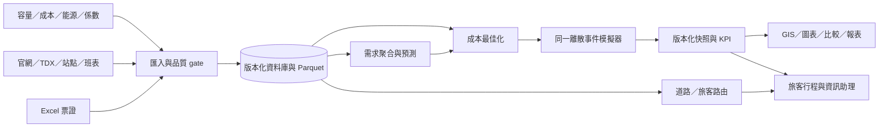

# 潭行 Twin — 完整軟體設計規格 v1.0

日期：2026-10-23｜語言：繁體中文｜狀態：規格基準 v1.0；本機原型已部分實作。正式完成狀態以 README、實際程式與驗收紀錄為準。

**使用者已確認：營運端以總營運成本最低為主；旅客端以票價最低為預設。兩者分開求解，保留服務與時間限制。**

本規格取代 v0.2 的設計決策；舊版留在 [archive/SPEC_v0.2.md](docs/spec/archive/SPEC_v0.2.md)。資料調查結果仍以原始檔與分析報告為證據。文中 MUST／必須為驗收要求；SHOULD／建議可在記錄理由後調整；ASSUMPTION 是可修改的設計假設，不能當業者現況。

## 0. 閱讀順序與文件權威

| 順序 | 文件 | 實作者應獲得什麼 |
|---|---|---|
| 1 | 本文件 | 範圍、產品決策、分期與系統架構 |
| 2 | [01_DATA](docs/spec/01_DATA.md) | 清洗、站點對照、資料表、來源版本、隱私 |
| 3 | [02_ALGORITHMS](docs/spec/02_ALGORITHMS.md) | 最低成本路徑、票價狀態、CP-SAT、需求預測、孿生事件 |
| 4 | [03_VISUAL_UX](docs/spec/03_VISUAL_UX.md) | 頁面、圖層、圖表、互動、狀態與響應式 |
| 5 | [04_API_ARCHITECTURE](docs/spec/04_API_ARCHITECTURE.md) | 模組邊界、API、非同步工作、錯誤、部署 |
| 6 | [05_CARBON_COST](docs/spec/05_CARBON_COST.md) | 柴油／電巴、成本、係數、充電、ESG |
| 7 | [06_ACCEPTANCE](docs/spec/06_ACCEPTANCE.md) | 可手算測資、驗收矩陣、失敗案例、效能 |
| 8 | [07_IMPLEMENTATION](docs/spec/07_IMPLEMENTATION.md) | 給較低階模型的任務單與逐步提示詞 |
| 9 | [08_SERVICES](docs/spec/08_SERVICES.md) | 使用者需要申請的服務、設定、替代方案 |
| 10 | [09_SOURCES](docs/spec/09_SOURCES.md) | 官方參考來源、查核結果與未證實資訊 |

衝突處理：本版明確決策優先於封存舊版；計算以 02／05 為準，欄位以 01／04 與 JSON 契約為準，畫面以 03 為準。若不同現行文件真的矛盾，先建立 issue 並修正文檔，禁止實作者自行選擇容易的一邊。驗收結果不得用來默默改弱要求。

## 1. 產品範圍

### 1.1 想完成的決策

營運端：「此刻的需求與服務壓力在哪裡？哪些判斷有可靠資料支持？在服務底線下，班次與車輛如何配置才使總營運成本最低？」

規劃端：「尖離峰與票證資料呈現什麼型態？未來需求可能如何變化？不同假設下，供需缺口和配置結果如何改變？」

旅客端：「目前有哪些已知服務資訊？若資料不足或沒有即時來源，如何清楚指出還不能確認什麼？」

共同介面以營運決策總覽為入口，將需求預測、票證證據、車隊供給、事件和資料新鮮度連到 GIS／數位孿生。營運成本最佳化與旅客票價查詢是不同工作流程；本階段主打營運成本，旅客路由保留為次要功能。

### 1.2 不得混淆的三種最短路徑

| 問題 | 圖 | 預設目標 | 執行者 |
|---|---|---|---|
| 旅客搭什麼車 | 有時刻與票價狀態的公共運輸圖 | 最低實付票價；同價再比抵達時間、轉乘與步行 | transit_router |
| 車輛如何調位 | 允許車型通行的道路圖 | 能源＋工時＋里程維護＋過路費最低 | road_router |
| 哪班開、哪車開 | 候選班次與車輛相容圖 | 總營運成本最低 | fleet_optimizer |

不允許將「OSRM 回傳的最快道路」直接標示成最低票價；也不允許用自由道路搜尋替換已核定載客路線。

### 1.3 用戶、權限、角色

| 角色 | 能做 | 不能做 |
|---|---|---|
| viewer／旅客 | 查聚合、行程、已發布知識、公開情境 | 看卡號、預約個資、修改來源與規則 |
| planner／規劃員 | 建情境、執行預測與最佳化、比較、匯出聚合 | 啟用未審核來源、下達真實調度 |
| data_admin | 匯入、對照、標記衝突、發布版本 | 擅自補造未知事實 |
| admin | 管理帳號／設定／工作取消 | 在 UI 看到 Secret 明文或把原始票證公開 |

本機開發可單一 planner 模式，只有 loopback 存取；對外部署前必須完成角色、來源清單、憑證與敏感資料隔離。

## 2. 已知證據與不可假設之事

- 已下載 2024／2025 Excel，原始非空列分別 875,149、925,761；不是去重旅次，也不是獨立乘客數。
- 出現 6670A/B/D/E/F/H、16 個計費站名。計費站不是精確實體站牌。
- 2025-07-07 缺交易且與官方停駛公告吻合；2024 五個缺日尚待查。
- 官網保存 80 個公開站內 HTML／HTM URL：69 有內容、11 顯示 404；下載 46 份附件。101 個含時間的原始表格仍需正規化。
- 原始交易沒有到站時刻、拒載人數、完整現金／套票乘客、核定容量、GPS、能源、成本、勤務。
- 官網是供給與規則知識；現行頁不能證明 2024 年完整歷史班表。其他線沒有對應交易訓練資料。

原始調查：[DATA_FINDINGS](analysis/DATA_FINDINGS.md)、[官網整合](analysis/NTBUS_WEBSITE_INTEGRATION.md)。

## 3. 功能需求編號與完成範圍

| ID | 功能 | 第一版輸出 | 優先級 |
|---|---|---|---|
| FR-01 | 票證匯入與品質 | 可重跑、列數對帳、隔離清單、版本 manifest | P0 基礎 |
| FR-02 | GIS 基礎網路 | 子線、方向、站群／實體站及品質圖層 | P0 基礎 |
| FR-03 | 尖離峰／OD／行為 | 日曆、時段熱圖、OD 矩陣、匿名重複搭乘統計 | P0 核心 |
| FR-04 | 旅運需求預測 | 可回測 baseline、時間切分、區間、資料不足；經驗證後再升級 AI 模型 | P0 核心；進階模型 P1 |
| FR-05 | 歷史與模擬孿生 | 時間軸、車輛狀態、乘客守恆、排隊 | P0 核心展示 |
| FR-06 | 旅客最低票價 | 有時刻約束的費用搜尋、費用拆解、搜尋界線 | P2 |
| FR-07 | 道路最低營運成本 | 合法路網、車型限制、成本解釋 | P1 |
| FR-08 | 班次／車輛最佳化 | CP-SAT 成本最小、服務約束、下界／gap、模擬驗證 | P0 核心原型；營運校準後方可實用 |
| FR-09 | 方案比較 | 同需求／邊界下比較成本、服務、載客與碳排 | P0 核心 |
| FR-10 | 旅客／營運問答助理 | 問句理解、白名單唯讀查詢、來源與時間戳、事件排除指引 | P1 次要 |
| FR-11 | 景點與完整行程 | 去回程、開放時間、末班、轉乘緩衝 | P1 |
| FR-12 | 電巴與 ESG | 活動數據法、係數版本、能源／成本情境、SOC | P0 比較；充電調度 P1 |
| FR-13 | 即時監控 | GPS／ETA 新鮮度、事件串流 | P1 接通來源後；沒有來源時只呈現歷史／模擬 |
| FR-14 | DRT／新接駁 | 容量時間窗取送路由、核准道路、營運檢核 | P2 |

P0 的最低成本必須有真正演算法與可核對例子。不得用排序幾張手寫方案卡取代求解器。

## 4. 系統架構決策

ASSUMPTION：開發機可執行 Node.js、Python 與 Docker；正式版本鎖定當時相容依賴，不在規格宣稱特定套件為最新版。

- Web：React＋TypeScript＋Vite；MapLibre GL JS；ECharts；TanStack Query；Zustand 管視圖狀態。
- API：FastAPI＋Pydantic；PostgreSQL＋PostGIS；SQLAlchemy／Alembic。
- 分析：DuckDB＋Parquet 做批次，Python 做品質、預測、圖搜尋、OR-Tools CP-SAT；SimPy 作離散事件封裝。
- 工作：獨立 Python worker，Postgres 工作表與 `FOR UPDATE SKIP LOCKED`；初版不強制 Redis／Kafka。
- 底圖：MapTiler 轉接器為預設建議；無 key 時用合法本機底圖或空底圖＋GeoJSON，狀態明示。
- 詳細 3D：P1 可用 Three.js 顯示單站或車輛；不另建一份物理／營運模型。
- LLM：目前使用 OpenCode OpenAI 相容 API 與 `deepseek-v4.1-flash`，僅由後端呼叫，provider/model 可替換；API key 僅存本機 `.env.local`／部署 Secret。LLM 負責語意理解和組織回答，資料由白名單唯讀工具取得，數值由確定性 API／程式計算。禁止自然語言直接執行任意 SQL、shell、Python 或車隊寫入命令。端點已確認可達；目前 OpenCode 帳戶回 HTTP 402，模型成功生成尚待帳戶額度恢復後驗收。

## 5. 三種模式與證據等級

| 模式 | 內容 | 車輛位置 | 允許主張 |
|---|---|---|---|
| historical | 歷史刷卡與可用班表 | GPS 實測或重建；分別標示 | 觀測票證與重建結果 |
| simulation | 固定輸入版本與 seed 的情境 | 模擬路段進度 | 假設下的模型輸出 |
| live | 經驗證即時來源 | 最新且未過期 GPS | 已接來源的即時狀態 |

UI 全域固定顯示模式、服務日期、資料版本；live 未接通時不能以 demo 自動取代而不告知。每個數值回傳 `quality`（observed／derived／assumed／missing／stale）與 `source_ids`。

## 6. 第一版重要產品決策

1. 以 6670 家族一個核對過的方向廊帶先完成；能新增子線但不可把所有子線合成單一停靠序列。
2. 固定線先最佳化發車候選與車輛指派；中途站、時刻與最低服務是限制，不因省錢任意刪站。
3. 旅客票價與業者成本分開呈現，不將業者油耗當旅客票價。
4. 無約束的省錢解可能是零班車；本系統必須先指定服務底線，再求最低成本。無解就說無解。
5. 比較 A/B 需相同需求、期間、係數邊界、路網版本；資料不一致須顯示並禁止百分比排名。
6. 不以最大載客率為單一目標；同看中途站未服務、等待、服務頻率。
7. 票價未核對時可做合成測資最低票價；真實查詢只顯示「目前已知票價方案中最低」，並列缺漏。
8. 必須提供來源視窗、成本拆解與限制說明；限制違反時不顯示綠色成功。

## 7. 視覺化主體與頁面

操作模式採 Operate：地圖與決策優先，資訊密度可控。預設桌面 1440×900、筆電 1280×800；旅客頁兼容 390px。視覺系統是提案，並非已通過用戶測試。

| 路徑 | 核心視覺 | 核心操作 |
|---|---|---|
| /operations | 營運狀態摘要、GIS／3D場景、需求與供給、異常佇列、資料新鮮度 | 選資料模式／日期／子線；點異常檢視證據並建立情境 |
| /demand | 預測與實際趨勢、信賴區間、週×時段熱圖、回測品質 | 篩選路線／方向／期間，切換 baseline 與已驗證模型 |
| /tickets | 票證交易時段曲線、OD矩陣、票種／子線分布、隱私安全頻次 | 分析尖離峰、客源方向與樣本限制 |
| /optimization/:jobId | 成本—服務散點、成本瀑布、車輛甘特、候選班次差異 | 設服務底線並比較最低成本可行方案 |
| /scenarios/:id | GIS／數位孿生、事件軌、參數表、車輛甘特 | 修改假設、驗證、執行與比較 |
| /assistant | 旅客與營運人員共用問答、資料引用、服務狀態與排除步驟 | 以自然語言查詢公開／授權資料；預覽情境計算 |
| /journey、/green、/data | 次要旅客規劃、永續分析及資料管理 | 依角色和需求進入 |

前端導覽分為「營運工作台」（總覽、需求預測、票證分析、數位孿生）、「規劃」（班次最佳化、情境比較）和「智慧服務」（問答小幫手、旅客行程）。任何介面顯示的即時狀態都要帶來源名稱、資料時間和新鮮度；未接即時 feed 時用明確的「目前沒有即時車況來源」，不得用模擬車輛填補。

參見 [03_VISUAL_UX](docs/spec/03_VISUAL_UX.md) 的每張圖資料契約與互動規則。不存在資料的圖表顯示缺件清單，不能填入漂亮隨機曲線。

## 8. 交付階梯與資料依賴

| 階梯 | 可交付結果 | 不能宣稱 |
|---|---|---|
| L0 合成測資 | 小圖最短成本、排班、守恆、頁面互動驗證 | 真實南投營運成效 |
| L1 原始資料分析 | 歷史 OD、時段、來源品質、基線預測 | 全乘客需求、真實拒載 |
| L2 校準模擬 | 真實路網與核對班表＋假設容量的方案 | 可直接上線調度 |
| L3 業者資料驗證 | 容量、人力、能源與實際車次驗證 | 未校驗範圍的有效性 |
| L4 即時試行 | 授權唯讀介接與人工決策 | 自動寫入真實車隊控制 |

每個頁面與匯出須顯示所屬階梯。API key 未取得不阻止 L0/L1，但會限制真實地圖／供給。

## 9. 效能、品質與完成判準

- 指標分子分母可追溯、未知不是 0、空分母回 null。
- 金錢內部整數分，時間整數秒，距離公尺，能源 kWh／L，碳排 kgCO2e；不得混合單位。
- 小型圖搜尋必須與窮舉 oracle 相同；大型限定時間求解要揭露近似與 gap。
- 相同輸入、seed、演算法版本的事件輸出可重現，畫面播放速度不改數值。
- 原始 180 萬列不可傳給瀏覽器；資料庫聚合與分頁。
- 目標工作量與目標時間列於驗收文件，沒有量測前不可標已達標。
- 可編輯設定需有合理範圍、錯誤訊息與原子驗證。
- P0 出貨：資料可對帳＋三種路由／最佳化的合成測試通過＋孿生守恆＋主要畫面互動＋API 契約＋建置通過。

## 10. 實作交接入口

直接將 [07_IMPLEMENTATION](docs/spec/07_IMPLEMENTATION.md) 最後的提示詞貼給下一個模型。一次只派一個任務；先用合成小測資驗證演算法，再替換真實資料。實作者不得因模型能力較低而改成假資料動畫、固定答案或以 LLM 取代求解器。

使用者現在可準備的服務請看 [08_SERVICES](docs/spec/08_SERVICES.md)。本次規劃不要求先購買付費服務。

## 11. 碳排參數與地圖服務狀態

使用者提供的柴油 SORT 1–3 範圍 1.585–2.123 kg/km 先保留為未查證敏感度參數。已查核的另一組歷史資料為柴油 1.173、電巴0.727 kg/km；其推導使用 0.509 kg/kWh、0.7 km/kWh，不和0.474／0.467年度電力係數直接混算。官方2025係數依一般公用售電業、產業盤查、住宅用途各有不同，須依使用者／服務適用類別選用。詳見[05碳排成本](docs/spec/05_CARBON_COST.md)及[來源表](docs/spec/09_SOURCES.md)。

底圖使用MapLibre＋MapTiler public key；已修正Vite worker URL並於本機瀏覽器驗收街道圖磚和官方GeoJSON疊圖同時顯示。正式部署仍須設定Allowed Origins及用量限制。TDX OAuth與Bus v2 InterCity靜態路線／站序／WKT線形已於2026-10-23取樣成功；這不表示時刻表、GPS、ETA、餘位或票價即時連線。詳細狀態見[服務準備](docs/spec/08_SERVICES.md)。

## 2026-10-23 數位孿生整合更新（目前實作優先）
主站「數位孿生」已合併原「班表情境」，使用 scenario-lab 的單一引擎，43人容量、一分鐘步進。舊簡化孿生已退出主站執行路徑；此前雙模型描述僅作歷史參考。需求倍率、日期、現行／建議班表和壅塞共用；離開工作台暫停，返回保留狀態。獨立的合成候選最低成本求解仍是研究範例，未接正式營運調度。詳細實作與界線見 scenario-lab/README.md、docs/IMPLEMENTATION_STATUS.md。
