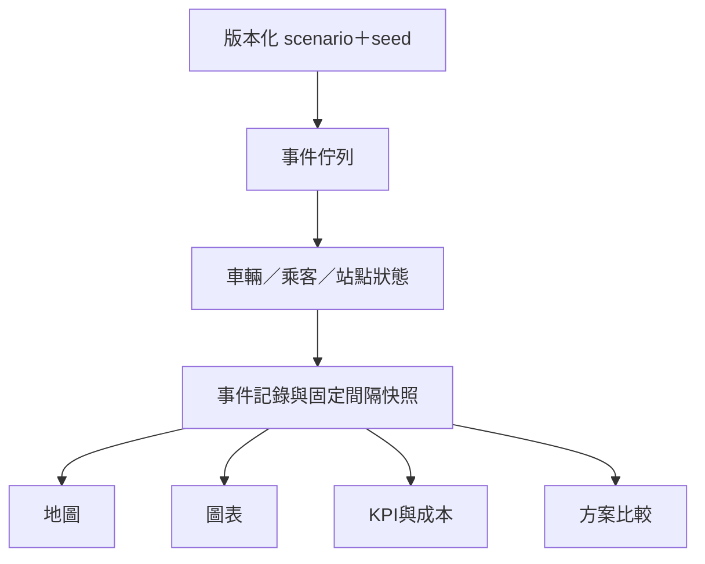

# 02｜最低成本演算法、需求預測與數位孿生

本文件為計算權威。所有範例為合成測資，不是南投真實票價、車容量或成本。不得用 LLM 回答代替以下求解。

## A. 最低成本的共同契約

每次求解輸出：`algorithm`、`algorithm_version`、`objective`、`search_scope`、`constraints`、`input_versions`、`solution_status`、`optimality_scope`、`objective_minor`、`best_bound_minor?`、`relative_gap?`、`elapsed_ms`、`warnings`。

| 狀態 | 意義 | UI 字樣 |
|---|---|---|
| optimal | 在完整指定模型／候選集合已證最優 | 此搜尋範圍內最低成本 |
| feasible | 有可行解，未證最優 | 目前找到的最低成本可行方案 |
| infeasible | 指定模型已證無解 | 在這些限制下無可行方案 |
| timeout_no_solution | 到時間仍未找到可行解 | 搜尋逾時，尚無方案 |
| incomplete_data | 必要輸入缺失 | 資料不足，不能判定最低成本 |
| model_invalid | 單位／模型本身錯誤 | 模型驗證失敗 |
| cancelled | 使用者取消 | 已取消；完成部分不當正式方案 |

`optimal` 不表示真實世界所有可能均已搜尋。必須說明日期、圖覆蓋、票價產品、候選時刻、需求、資料版本。啟發式裁剪、時間中止、未核對票價均不得使用無限定的「全域最低」。

## B. 旅客最低票價：時間展開圖＋資源標籤搜尋

### B1. 輸入／輸出

輸入：起點／終點實體站或座標、出發日、earliest_departure、latest_arrival、票種／已持票券、allow_purchase_products、max_walk_m、max_transfers、accessibility、required_POIs?。

預設 ASSUMPTION：最大旅程 6 小時、最大總步行 2,000m、最多換車 2 次、普通票、已持票券空、無障礙未要求。這些在 UI 可改且出現在結果上。沒有 latest_arrival 時自出發起算 6 小時，不能無限等到隔日便宜車。

輸出至少一個 lowest_fare，另可獨立求 earliest_arrival、fewest_transfers。不同 objective 要分別求解，不對最低票價結果隨意重排冒充最快。每段含 boarding/alighting、trip_id、實體站、步行、buffer、fare_charge、付款產品、有效期、查核來源與未知限制。

### B2. 為何不能只對站點跑 Dijkstra

相同站點在 08:10 與 08:50 有不同可搭班次；持套票與現金票的後續成本不同；總步行及轉乘會限制可行路徑。因此狀態至少包含：

```text
(event_node, fare_state, current_trip_or_none, transfers_used, walking_used_m)
label = (paid_minor, arrival_s, transfer_count, walk_m, predecessor)
fare_state = (purchased_product_set, remaining_uses, active_validity,
              previous_charge_context, boarding_fare_origin_if_onboard)
```

同節點、同未來付費權益與同上車狀態才可做 dominance。便宜但更晚或步行更多的 label 不一定支配另一個。最簡可靠 P0：保留資源精確狀態，不做有損步行取整；使用 Pareto label pruning，全部資源不大於才支配。

### B3. 時間展開網路

1. 載入當日有效服務日曆與例外，排除已確認取消班次。
2. 建每一停靠的 arrival／departure event node；含 trip、stop_occurrence、絕對服務秒。
3. 建 ride edge：同車次相鄰站，時刻不可倒退。
4. 建 board／alight edge：依 pickup/dropoff、報到資格、車種限制。
5. 建 wait edge：同站相鄰可等待事件，非負時間。
6. 建 walk／transfer edge：合法步行圖求得可達時間，接到滿足 arrival＋walk＋buffer 的後續 departure。
7. 同車不換車的跨路線 service continuity 需明確對照；無證據視為換車。分段票價仍計費。
8. source 接可達首班，sink 接目的地／目的地步行；跨午夜用正確 service_date 與絕對秒。
9. POI 訪問以 visit state 表示，加入開放時間與停留邊；P1，第一版固定順序，任意重排需另解時間窗旅行商問題。

步行與 buffer 分開：walk_s 是空間移動，min_transfer_s 是額外乘車緩衝；同站轉乘若已有總最短轉乘時間，先換算避免兩次加上步行。預約報到時間屬乘車資格，不能混進所有公車 buffer。

### B4. 票價引擎

介面：`evaluate_fare_transition(fare_state, action, context) -> (new_state, incremental_charge_minor, evidence)`。

- OD 單程票可在下車邊結算，onboard state 保留上車計費區；中途同車不重收全程費。
- 已持有效票券：本次增量購票成本為 0；另顯示既有票券 sunk_cost，不再重收。
- 新買套票：purchase edge 一次收全價，建立權益；不是每乘一段都收完整套票價。
- P0 僅接受已核對、可非負增量結算的票制；規則未知返回 unsupported，不猜優惠。
- 轉乘優惠在可確定結算時收淨額；若必須事後退款形成負邊，P0 不支援該產品完整最優保證。不可把負值直接塞 Dijkstra。
- 過期、日期、適用線／方向、乘次、票種資格都進 state transition。
- 必須輸出全旅程總實付（如來回套票要比整趟），不能拿單程便宜與來回總價混比。
- `fare_coverage` 包含已納入與排除的票種；不清楚現行票價時只做示例或已知範圍比較。

### B5. 搜尋與停止規則

```text
validate query and required data
build finite time-expanded graph for query horizon
initialize heap with source label, priority=(paid, arrival, transfers, walk, stable_id)
while heap not empty:
    if deadline exceeded: return best feasible + truncated_scope, or timeout_no_solution
    label = pop smallest priority
    if dominated by same future-equivalent state: continue
    if label reaches valid sink: record candidate
    for valid edge in outgoing(label.node):
        reject if illegal, out of horizon, excess walking/transfers, inaccessible
        apply fare transition; reject unknown required charge or negative increment
        produce next label; prune only proven dominance
        push if new nondominated label
    stop only when heap lower bounds cannot improve full lexicographic incumbent
return best candidate with scope
```

最安全小網路先搜完 finite graph 取得正確結果，再做 lower-bound 提早停止。非負 primary cost 可支持 label-setting；同價 tie-break 與 transfer 資源要一起證明，不能找到第一條目的地路徑就不分條件宣稱最佳。

label 數可設工作預算，但觸及預算必須回 feasible/timeout，`search_complete=false`；不得砍到每站一筆還聲稱精確。拓撲完整後可評估 RAPTOR 類加速，但不是 P0 必要，不可未驗證就替換。

### B6. 最低票價例子

合成 08:00 從 A 出發，抵達期限 09:30：

| 路徑 | 時刻 | 票價 | 結果 |
|---|---|---|---|
| A→C 直達 | 08:00–08:40 | 120 元 | 快，但較貴 |
| A→B→C | 08:05–08:25、08:30–09:00 | 40＋50=90 元 | 可轉乘，最低票價 |
| A→B→C 早班 | 08:05–08:25、08:20–08:50 | 40＋20=60 元 | 錯過轉乘，不可選 |

轉乘 buffer 300 秒時 08:30 可搭；600 秒時不可搭。最晚 08:45 抵達時選 120 元直達。必須同時測這三個情境。

有實際餘位才檢查 seat availability；無即時餘位時輸出 seat_status=unknown、仍可算時刻／票價可行性但不能保證搭乘。旅客查詢不得改動座位庫存。

## C. 道路最低營運成本：有向圖 Dijkstra／A*

### C1. 適用範圍

用途為車輛調位、核准接駁候選道路、以及事故替代路徑草案。固定班車的載客路線使用已核對 shape；演算法不得自行讓車鑽小路、跳站或逆向。

圖採有向路段，必要時將 incoming_edge 納入狀態處理轉向禁令。需車高、車重、車型、單行、國道入口、禁行、封閉時間；未知關鍵通行條件標 needs_review，不能稱可直接執行。

### C2. 邊權成本（全部轉成整數分）

```text
edge_cost = energy_consumption × energy_price
          + travel_time_hours × driver_cost_per_hour
          + distance_km × non_energy_maintenance_per_km
          + toll_per_pass
```

柴油 consumption 用 L，電巴用 kWh；能源係數未知時可用明示示例。不能同時套一個含油耗的每公里總成本再加燃油。Toll 若跨多段才計一次，加入 toll_state 或以完整 toll segment 計費，避免重收。

有固定出車費的同車單一路徑比較可外加一次；多車／多趟啟用費由 fleet solver 算。

- P0：某時段固定旅行時間快照、非負成本，Dijkstra 精確求解該圖。
- A* 可用 `h=0` 先保證正確；啟發函數只能是可證的成本下界，例直線距離×全圖最小非負每公里成本。不拿平均速度／平均油耗當必然下界。
- 有交通時間窗／封閉時間且進邊時間影響成本：P1 時間展開圖或保證 FIFO 的 time-dependent search；普通靜態 Dijkstra 不夠。
- 電巴帶 SOC 資源時，單純最低金錢路徑可能不可行；使用有限 SOC 狀態／資源受限 label search 或先固定經校驗路徑交 charging solver。
- 負再生能源成本不可當負金錢路段；回收能源限制於電池空間並用保守耗能模型。P0 不模擬連續坡度回充。

OSRM 可以提供幾何、時間／距離矩陣候選，但預設最快路徑不等於本成本目標。若只比較其有限候選，結果必須標「候選路徑中最低」，不可宣稱整張道路網最低。

### C3. 可手算例子

合成 S→T：高速路 10km、600s、過路費40元；地方路12km、1200s、無過路費。非工時綜合變動成本10元/km，駕駛120元/hr。

高速=100＋20＋40=160元；地方=120＋40=160元。平手依時間選高速。改高速 toll=60元則高速180，地方160，選地方。所有通行限制通過才可選；最晚抵達 900s 限制下只能選高速。

## D. 班次與車輛最佳化：OR-Tools CP-SAT

### D1. 先固定決策空間

P0 是「核對過的固定線廊帶、單日、可用車隊、候選發車時間、單程直達 OD cohort」。不處理任意新增載客路線、跨線旅客聯合選路或完整駕駛勤務最佳化。

每個原班次建立互斥 alternatives：原時間與 ±10/±20 分鐘（5 分鐘格，ASSUMPTION）；僅在允許改時範圍使用。首末班／必開班鎖定。增班另建有限候選，可用站點與迴轉點必須核准。每個 candidate 已有停靠時刻、距離、方向、車型相容性、能源與成本。

候選生成回傳原始數量與被排除理由。無數據不得生成現實已核准的車型／充電點。`optimality_scope=candidate_set`。

### D2. 集合與變數

- V：可用車；T：候選班次；G：互斥班次群；S_t：班次路段。
- Q：需求 cohort（起訖、到站秒、人數）；W：需求情境 low/base/high，可單情境先實作。
- A_v：車 v 可連接班次弧，含起點 depot、終點 depot。只保留前班結束＋調位＋迴轉≤後班開始。
- y[v,t]∈{0,1}：車 v 是否執行 t；h[t]=Σv y[v,t]∈{0,1}。
- z[v,i,j]∈{0,1}：車的連續任務；use[v]∈{0,1}。
- x[w,q,t]≥0 整數：q 在情境 w 分配至 t 的人數；只建立可搭且起訖順序合法的組合。
- u[w,q]≥0 整數：未服務；不能偷偷移出需求分母。

### D3. 必備限制

1. 每候選至多一車：Σv y[v,t]=h[t]≤1。
2. 互斥：每原班群 g 的 Σt∈g h[t]=1（必保留服務）；可取消群需政策允許才≤1。增班群按上限。
3. 車輛流守恆：Σincoming z[v,i,t]=y[v,t]=Σoutgoing z[v,t,j]；depot start/end 各等 use[v]。班次時間嚴格遞增形成 DAG，防止無 depot 子迴圈。
4. 需求守恆：Σt x[w,q,t]+u[w,q]=d[w,q]。
5. x 只能上在 q 到站之後且 max_wait 之前的班，終點必在上車站之後；x≤d·h。
6. 每路段：Σ跨該段 q 的 x[w,q,t]+reservation_external[w,t,s]≤Σv cap[v,t,s]·y[v,t]。
7. 已含於 demand 的預約 cohort 不再計 external。外部保留／預約依區間與釋位政策生成；嚴格保留策略與模擬一致。
8. 全體服務：Σu≤floor((1−min_served_ratio)Σd)。預設示例 min_served=0.95；每 OD／站群≤floor((1−min_group_served_ratio)d_group)，示例0.90；小樣本整數效果須顯示。
9. 必要班次、首末班、每個服務窗口最低班數、最大間距。最簡 P0 使用經檢查覆蓋全期間的 sliding windows，每窗至少一班；邊界窗口包含首末班條件，避免末端漏檢。
10. 可用時段／車型／容量／迴轉／國道不可站立／輪椅條件不可放寬。
11. 駕駛資料缺少：只作車輛可行性＋成本假設，結果 operational_ready=false、標待勤務檢核；不可宣稱真實可執行。

最低服務比例、等待45分鐘、最大班距60分鐘是可修改 **示例政策**，不代表南投客運承諾。正式 solver 請求必須帶 policy_version，不可藏在程式 magic number。

### D4. 目標：先限制可行，再最小總營運成本

```text
C_operating = Σ[v,t] y[v,t] × in_service_variable_cost[v,t]
            + Σ[v,i,j] z[v,i,j] × connection_cost[v,i,j]
            + Σ[v] use[v] × incremental_activation_cost[v]
            + approved_schedule_change_cost
```

班次成本包含服務能源、里程維護、服務工時；連接成本含調位能源、調位維護及應付等待／迴轉工時，首末 depot 弧含出入場。不能只算載客公里，也不能多次算同一人工時段。

工時 P0 用每車一位可用駕駛的 duty span 近似計費，無法驗證實際勤務時標假設；如使用固定整班薪資，不再逐段累加同一薪資。成本邊界請求必選一種。

min C 是 primary。完成最優或取得可行 incumbent 後可用二階段 tie-break：在 primary≤C_best 的可行集合內最小未服務→等待→變更；若第一階段非 optimal，第二階段不提升為 globally optimal。不可用極大常數混合不同比例而不檢查溢位。

服務門檻 infeasible 時，回傳限制衝突／不足資源線索。可另外啟動 diagnostic 模型求最小違反，但它必須標 NOT_EXECUTABLE；不自動放寬原模型。

### D5. 可靠性與不確定性

P0 base 情境求解，再以 low/high 到站與行車時間回放；每個方案呈現敏感度。P1 robust：共享 y/z，對每個 w 使用不同 x/u，要求各情境都滿足服務限制；旅行時間用指定保守值建相容弧。不能只將 P90 passenger forecast 當已知精確需求。

求解時間建議60s、固定 random_seed、規格 fixture 用單 worker；大型多 worker 結果可能不完全重現，記錄 threads/version。`best_bound` 與 incumbent 同單位；minimization gap=max(0,obj−bound)/max(1,abs(obj))。整數分求解，官方 solver 狀態映射見 04。

### D6. 求解後必須跑同一模擬器

CP-SAT 的 x 是規劃分配，不代表現場能控制未預約乘客選哪班。回放一般候車採 FIFO，已預約依政策處理；若 FIFO、晚點或保留釋位讓原解服務指標失敗，標 simulation_failed，不列為已驗證最低成本方案。

最多 ASSUMPTION 3 輪：求解→模擬→更新瓶頸／排除不可行候選組合→重解。保存所有輪次。有限迭代只得到經模擬可行的候選，不宣稱原始連續問題最優。

### D7. 合成最低成本 oracle

同一需求40人、單一路段、同時間、全部須服務；候選 L 車容量40成本1000元、S 車容量20成本600元，最多一輛L、兩輛S。最優 L 一台1000，兩台S1200。L不可用時必須兩S；只有一S可用則 infeasible，不能省錢只載20人。

## E. 需求預測與旅客行為

### E1. 預測目標

優先預測「可觀測票證搭乘量」，站群×方向×15分鐘／60分鐘；不是潛在全乘客到站需求。另以情境參數補非票證涵蓋、拒載與到站分布；這些不混進實測標籤。

Baseline：同星期／同時段近4個有效週 median；不足4週用已知有效週，少於2週回資料不足，另可顯示全線上層估計並標 fallback。closed/missing day 不作正常零。

P1 模型：LightGBM count／Poisson 類或 quantile regression；以嚴格時間回測挑選，未勝過 baseline 不自動升級。小樣本子線可做 pooled model，以 pattern/direction 參數區分；不得拿未見過的線輸出高信心。

### E2. 特徵與洩漏

歷史lag 1/7/14/28日、過去rolling、星期、時段、法定假日與已知活動。預報天氣必須是 forecast issue time 前已發布的預報；未取得歷史預報則不拿事後實測天氣假裝當時知道。標準化／特徵編碼／分群都只用 train fit。

建議固定 protocol：train 2024＋2025-01至06、validation 2025-07至09、test 2025-10至12。validation 可 rolling-origin；所有超參數先凍結再一次 test。若實際服務／資料異動不支持此切分，記錄原因改版，不能挑效果最好日期。颱風停駛日保留事件分析但排除正常需求誤差或獨立報告。

MAE、WAPE、peak-bin MAE、各方向誤差、80% interval coverage、pinball loss；真實總量0時 WAPE=null。預測區間需校準，沒有做 quantile／conformal 時只顯示歷史分位範圍，不冒稱預測信賴區間。

### E3. 行為

目標指標允許聚合頻率、OD 重複率、同卡返回間隔分布；P1 可標準化特徵後 K-means／HDBSCAN，但群名是描述型，不能宣稱通勤者／觀光客真實身分。重複卡可連結性不明時停用跨年分析。

目前原型對回程間隔採保守代理：僅在同一月份工作表、同一卡號、同一服務日內，按上車刷卡時間排序，配對非重疊的反向計費站 OD，間隔 >0 且 ≤12 小時；區間為 `<1h`、`1–2h`、`2–4h`、`4–12h`。每格少於 k=10 不輸出數值。卡號僅用於本機記憶體聚合，不能輸出、地圖化或送至 LLM。此配對可能把非返程的反向行程當作回程，且計費站不等於實際站牌；介面必須稱為「代理配對／計費站推估」，不可解讀為完整旅次、乘客人數或個人軌跡。

## F. 離散事件數位孿生

### F1. 單一模型狀態



引擎不得 import DOM／MapLibre／Three.js。前端播放只讀 snapshots；動畫只插值位置，不能新增載客或碳排。

### F2. 狀態與事件優先序

車輛：available→deadhead→in_service↔dwell→layover→available；另有 charging、unavailable、retired。乘客：not_arrived→queue→onboard→completed，或 abandoned／waiting_rescue。

事件 heap key=`(sim_second,priority,stable_event_id)`。同秒優先：路段封閉／取消→車輛抵達與下客→乘客到站／預約核銷／合法釋位→上客→發車→快照。發車同秒到站是否可搭採「到站≤關門時間」，關門由獨立 departure_cutoff_s 決定；不要靠不穩定執行序。

先下後上；不同路線 queue 分別保留資格，不能全站一條 queue 讓去錯目的地者堵住。FIFO 以 arrival_s,cohort_id 排序；可把 cohort 分割到不同班次，追蹤 parent_id 與人數守恆。

### F3. 到站、服務與放棄

無觀測到站時刻，至少支援 uniform_bin 與 before_departure_clustered。時間由 seed 衍生並固定保存；比較A/B使用同批到站 realization，不因方案不同重抽有利需求。

需求增加 multiplier 僅標 synthetic；峰值移動需守恆（從原 bins 扣除再加至目標），不得無意新增需求。放棄閾值可用固定秒或明示分布；未服務包括放棄、期末仍排隊與未完成行程，分開列。

### F4. 容量與保留席

同一預約 cohort 只計一次。保留 policy 以 trip、區間、報到／釋位設定決定。在上客決策時對欲搭乘的每段檢查餘裕；旅客在保留區段前已下車，可使用不重疊空間。

```text
projected_onboard(segment) + active_unboarded_hold(segment) <= capacity(segment)
```

車上旅客已含於 projected_onboard 時不再是 unboarded_hold。Hold 過期不直接轉成實際到站旅客；取消 hold 只改席位，不憑空生人。

無障礙座位與輪椅空間需 configuration（輪椅占用可能減少普通座位）。未知時不承諾無障礙搭乘。

### F5. 路段運行與故障

區間行車時間由可核對資料／示例明示；總旅程刷卡時長不能平均拆成每段真實速度。路段事件決定進邊時適用的 travel_time，當車已在路段上遇封閉採情境明示：完成到下一安全停靠或等待，不能瞬移改道。

故障：停止後續 dispatch，車上乘客移至 waiting_rescue，救援接駁算車公里與等待；不得直接刪除乘客。取消班次未上車者保留 queue／改派；已執行路段成本與里程不回沖。

### F6. KPI 不變量

```text
arrived + initial_passengers = queue + onboard + completed + abandoned + waiting_rescue
onboard >= 0; queue >= 0; all passenger counts integers
boarded <= capacity constraints on every used segment
vehicle_km = service_km + deadhead_km + rescue_km
passenger_km = Σ segment_onboard × segment_length_km
capacity_weighted_load = passenger_km / Σ(capacity_segment × length_segment_km)
```

期末 queue/onboard/rescue 全部保留。等待 p50/p95 對已上車者計算，另列未上車的右設限等待與人數；不能只報已上車者看似改善。最高單段載客率與距離加權載客率是不同欄。

### F7. 播放、快照與重現

快照每30模擬秒（ASSUMPTION），重要事件另存；前端5秒粒度插值不等於引擎5秒步長。1×/10×/60×只影響播放器。暫停僅停止播放；計算工作可背景完成；「取消運算」是不同按鈕。重設播放回到0，不刪run；重跑產生新run_id。修改情境增加revision，不能覆寫完成run。

隨機種子分 demand／travel／failure 子流；求解器 seed 單獨記錄。各 seed 來源固定，前端不得 Math.random 決定實際運量。

## G. 後續 DRT 與電巴的明確邊界

DRT 使用 pickup-and-delivery VRP with time windows：同車取送、先取後送、容量、最大繞行／乘車時間、服務窗口、車庫、車型合法路段。目標為車輛啟用＋里程／時間／能源成本；不能把 OR-Tools 預設最短距離例子換標題就稱最低總成本。啟發式只標 feasible。

電巴充電／SOC 依 05。未建充電可行性前，只能比較相同路程的估算排放與成本；不得把柴油班表直接換電巴就稱可執行。
