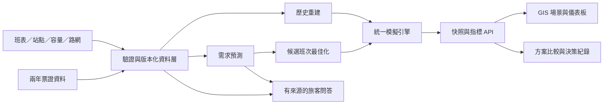

# 潭行 Twin｜日月潭公共運輸智慧營運數位孿生

軟體設計與競賽提案草案 v0.2｜2026-10-23｜供討論，尚未實作或驗證模型成效

v0.2 加入南投客運官網的班表、服務規則、預約、觀光接駁與事件資料。新增設計見第 17 節；完整盤點見 [官網整合提案](analysis/NTBUS_WEBSITE_INTEGRATION.md)。本次完成資料快照與規格增補，尚未將原始班表轉成可執行排班資料。

## 1. 產品主張與範圍

以 2024、2025 年 6670 刷卡資料建立需求底圖，讓南投客運在 GIS 場景中重播歷史、預測需求、比較班次方案，回答「哪裡可能塞客、何時加車、如何兼顧候車時間、成本與碳排」。

主使用者是營運主管與調度員，旅客資訊服務為同一套資料與模型的延伸。第一版聚焦 6670 路線家族與已確認的子線、方向、站點版本，不直接擴張至全南投。ASSUMPTION

競賽核心展示：選擇一個歷史假日 → 在 GIS 顯示旅次與估計車流 → 加入需求增加與路段延遲情境 → 產生班次候選方案 → 比較服務水準、資源使用與排放估算 → 顯示旅客可採取的替代出發建議。

第一階段定位為「以歷史資料校準的營運模擬孿生」。GPS、最新班表與即時事件串流接入並驗證後，才啟用即時監控模式。沒有感測資料時，移動中的車輛標示為推估或模擬。

### 完成這次規劃的交付

- 本規格：需求、資料契約、GIS、模擬規則、預測、最佳化、介面、驗收與階段計畫。
- `analysis/ticket_profile.json`：全列初步資料剖析；不是已清洗完成的旅次資料庫。
- `analysis/DATA_FINDINGS.md`：對規格有影響的資料發現。
- `scripts/profile_tickets.py`：可重跑的唯讀檢查；不輸出卡號與司機個人識別值。

## 2. 已知資料與使用邊界

已全列初查：2024 年 875,149 筆、2025 年 925,761 筆，共 1,800,910 筆原始非空資料列；不是去重後旅次或獨立乘客數。兩年皆有 6670A/B/D/E/F/H 六種子線、16 個不同計費站名。2024 有 5 個日期沒有紀錄，原因待查；2025 的缺日 07-07 與官網 2025-07-06 公告的颱風停駛吻合。兩者都不能直接當成零潛在需求。各工作表實際上車月份均符合標籤。詳見 `analysis/DATA_FINDINGS.md`。

兩年原始資料中最高量的單向 OD 都是「埔里站 → 高鐵臺中站」。產品敘事應同時涵蓋埔里—高鐵接駁與日月潭方向，不能僅憑競賽名稱把所有乘客視為觀光旅客。

兩份 Excel 各有 12 個月標籤工作表、18 欄，欄位包含：

| 類別 | 原始欄位 | 可支援內容 |
|---|---|---|
| 票證 | 票證公司編號、卡號、票種編號、票種代碼 | 票種分布；卡號跨期穩定性確認後的匿名重複搭乘分析 |
| 營運 | 客運公司編號、路線公路編號、司機編號、車號 | 子線分析、候選班次與車輛運行鏈重建 |
| 上車 | 上車時間(上)、計費站序(上)、計費站名(上) | 時段需求與計費站層級起點 |
| 下車 | 下車時間(下)、計費站序(下)、計費站名(下) | 計費站層級終點與乘車時間 |
| 票價 | 交易實扣、原始票價、優惠票價、優惠額度 | 交易金額與票價分布；結算語意確認後才定義收入 |

一列暫解釋為一筆含上下車資訊的票證交易，需與業者確認沖銷、補刷、特殊票券與一筆多人等情況；筆數不直接等於獨立人數或全路線客運量。ASSUMPTION

### 不可由這兩份資料直接量測的資訊

- 乘客到站時刻、未搭上車或放棄搭乘的人數：不能把上車刷卡時間當成到站時間。
- 每輛車座位／核定容量、完整發車班表、空車班次、駕駛可排班工時。
- 連續 GPS 軌跡、站牌座標、道路幾何、實際排隊長度。
- 油耗、用電、空駛里程、成本與完整排放係數。
- 旅遊目的、國籍、居住地、遊客在景點的真實停留時間。

票證紀錄反映已被服務的需求。滿載造成的潛在需求截斷，不能只靠歷史搭乘量還原；情境中額外需求需明示假設並做敏感度分析。

## 3. 十項主題如何整合

P0 為競賽核心閉環，P1 為完成核心後的擴充，P2 為業者資料串接與營運試行。

| 主題 | 具體功能與輸出 | 依賴與限制 | 階段 |
|---|---|---|---|
| AI 旅運需求預測 | 主要計費站／子線／方向／30 分鐘的上車量預測，含 P10/P50/P90；次日班次需求概覽 | 先通過時間與站點驗證；稀疏站改 60 分鐘或站群 | P0 |
| 車輛與班次最佳化 | 班次移時、增班、車輛指派與可行性說明；列出服務優先、成本優先、折衷三方案 | 真實班表、容量、迴轉與人力限制缺少時僅為示例方案 | P0 |
| 尖離峰分析 | 星期×時段熱圖、方向不平衡、季節差異、異常日期 | 尖峰依各站分布定義，避免固定套用通勤尖峰 | P0 |
| 搭乘行為分析 | OD、票種、乘車時長、匿名重複使用頻率與同日往返候選 | 卡號不可當自然人；無觀測不能宣稱觀光／通勤身分 | P0 基礎，P1 深入 |
| 載客率策略 | 班次平移、可行的短區間加班、車型替換、離峰導流的模擬比較 | 容量、合法停靠與可迴轉點需確認；保留最低服務 | P0/P1 |
| 營運決策儀表板 | GIS 指揮台、風險站點清單、情境比較、決策紀錄 | 第一版回放／模擬；即時頁需資料新鮮度與離線狀態 | P0/P2 |
| AI 客服／旅遊資訊 | 有來源的時刻與站點問答、避開預測擁擠的出發建議 | 工具查詢班表與預測；不承諾座位，不自行捏造班次 | P1 |
| 票證大數據視覺化 | OD 流向、時間熱圖、站點氣泡、路段負載、差異地圖 | 前端僅用聚合資料與模型快照 | P0 |
| 景點與公運整合 | 景點—站點步行可達性、去回程與末班車限制、替代時段 | 需景點座標、步行網與班表；起點先限定既有路線站點 | P1 |
| ESG／低碳方案 | 車公里、人公里、排放強度與服務公平性共同比較 | 缺少距離／能源／係數則只顯示代理指標或假設區間 | P0 代理指標，P1 完整估算 |

## 4. GIS 與數位孿生場景

### 4.1 地理範圍與圖層

GIS 以臺中—埔里—日月潭廊帶為敘事範圍，精確線形以核對後的各子線幾何為準。ASSUMPTION

1. 真實地圖底圖、道路、地形與行政區；保留供應者授權與來源標示。
2. 方向化路線與站牌；同名、對向、歷史改名與計費站群不可直接合併。
3. 站點上車量、下車量、預測量；OD 流線可篩選前 N 組避免遮蔽。
4. 路段載客量／載客率，資料來源標記為觀測推估、預測或情境模擬。
5. 可點選車輛：車輛代碼、任務、估計乘載、下一站、來源時間。
6. 景點與步行接駁；第一版只用已驗證景點，不直接推斷遊客實際造訪。
7. 情境事件：需求增加、路段延遲、車輛退出、臨時加班。

初版採 2.5D GIS：可傾斜地圖、地形、簡化車輛模型、站點柱狀與流線。重點是操作後能看出調度影響；站場近景 3D 留作第二階段。ASSUMPTION

座標交換用 WGS84／GeoJSON；距離與緩衝區計算採公尺單位的適當投影或測地計算，不直接以經緯度差當距離。道路里程沿線累計，步行時間優先沿可通行路網計算。

### 4.2 三種資料模式

| 模式 | 真實已知 | 估計／未知 | UI 必須顯示 |
|---|---|---|---|
| 歷史回放 | 票證交易的時間、起訖計費站等 | 中間位置、完整班次、未觀測乘客 | 回放日期；車輛位置重建；站點匹配品質 |
| 情境模擬 | 使用的歷史／預測需求基線 | 到站分布、服務安排、排隊與結果 | 假設、種子、模型版本、模擬時間 |
| 即時監控 | 經驗證的 GPS／班表／事件資料 | 沒有即時票證時的乘載量仍為估計 | 資料時間、延遲、離線／過期；估計與實測分開 |

每個指標有獨立 provenance；「即時 GPS」不代表「即時載客率」。切換模式時清除不相容的狀態與指標，不累加至同一總量。

## 5. 核心使用流程與頁面

### 營運指揮台

- 頂部：模式、資料日期／模擬時鐘、子線、方向、來源品質。
- 左側：圖層、日期、時段、票種、預測版本、需求來源。
- 中央：GIS 地圖；點站看時段曲線與 OD，點車看班次與乘載。
- 右側：風險排序、解釋、建議操作、必要資源與限制。
- 底部：播放／暫停／速度／時間軸，以及人次、候車、車公里、排放等指標。
- 未知值顯示「資料不足」並說明缺哪個來源，不顯示為 0。

### 情境實驗室

複製基線 → 修改參數 → 檢查可行性 → 執行 → 保存結果 → 與基線並排比較。所有方案用相同需求抽樣種子，並保留多個種子的分布結果。

### 資料與模型中心

工作表實際日期、缺漏、疑似重複、站點匹配、班次重建可信度、模型回測與參數版本。此頁是營運可信度的一部分，不要求使用者理解內部程式。

### 旅客助理

提供出發站、目的地、日期與可接受時間範圍 → 查詢最新可用班表與有版本的擁擠預測 → 回覆建議班次、步行段與回程限制。歷史展示一律標記示範日期，不能回覆成今日可搭的車。

## 6. 資料工程與資料契約

### 6.1 處理流程

原始 XLSX 唯讀封存 → 逐工作表擷取 → 保留來源列號 → 時間與識別碼標準化 → 品質標記／隔離 → 計費站與地理站點對照 → 方向／班次重建 → Parquet 分區 → 查詢與模型資料集。

- 依「實際上車時間」分區，工作表名稱只當來源中繼資料。
- 卡號、車號、司機編號以識別碼語意處理，避免浮點變形或遺失前導零；原始值與標準化結果分開保存。
- 匿名旅客鍵採票證公司＋卡號的受控 HMAC；金鑰不進前端／版本庫。確認跨年編碼可比後才做跨年重複搭乘分析。
- 時區先假設 Asia/Taipei；保留原始 Excel serial 與 epoch，確認後產生含時區時間。ASSUMPTION
- 下車早於上車、過長旅次、同站上下車、月份不符先標記，不一律刪除；有效性依分析用途決定。
- 去重先對照來源檔、工作表、列號與完整交易特徵；沒有交易 ID 時，同卡同時同站不能無條件判成重複。
- 票種名稱可能在年度間改變；先建字典，不以字面名稱直接比較。
- 站序可能為計費序或方向相關序號，需按子線、方向與生效期間解碼。
- 一個計費站對應多個實體站時，保留站群或多重候選與信心等級；禁止製造精確站牌需求。

### 6.2 主要資料模型

| 表／物件 | 主鍵與重要欄位 | 粒度 |
|---|---|---|
| source_record | file_hash + sheet + row；raw_values、quality_flags | 原始非空交易列 |
| ticket_journey | journey_id；token、route_variant、board/alight time、fare_stop、vehicle_id、amount | 清洗後票證旅次 |
| fare_stop_mapping | variant + direction + fare_code + valid_from；physical_stop_ids、confidence | 有版本的計費站對照 |
| physical_stop / route_segment | 穩定 UUID；geometry、有效期間、順序、距離 | 實體站／方向化路段 |
| service_trip | service_trip_id；origin_time、stop_times、vehicle_id、source、confidence | 一次方向性服務班次 |
| vehicle / duty | vehicle_id／duty_id；capacity、availability、energy_type、break constraints | 車輛與工作任務 |
| demand_bucket | actual_date + time_bin + variant + direction + stop_group | 觀測交易量／估計需求 |
| forecast | forecast_id；issued_at、target_time、p10/p50/p90、model_version | 發布時點可重現的預測 |
| scenario / simulation_run | UUID；baseline_id、changes、seed、versions、status | 情境定義／一次運算 |
| twin_snapshot | run_id + sim_time；vehicles、queues、metrics、quality | 同一時間的統一狀態 |
| decision_log | decision_id；方案、接受／修改／拒絕、理由、操作者、時間 | 人工決策紀錄 |

所有計算結果回傳 `source_mode, observed_at, computed_at, model_version, data_version, quality`。時間欄位不可混用資料發生時間與接收時間。

## 7. AI 預測規格

### 任務與模型

第一個任務是「下一營運日，已觀測票證上車量」；初始粒度主要站群×子線×方向×30 分鐘。資料稀疏或站序不可靠時，退回子線×方向×小時。ASSUMPTION

Baseline：同星期同時段歷史中位數、上週同時段。候選模型：LightGBM 或其他梯度提升樹；先比較回測再決定是否需要深度學習。P10/P50/P90 使用分位數預測並做交叉修正與覆蓋率檢查。ASSUMPTION

候選特徵：星期、月份、時段、滯後 7/14/28 日、只用過去資訊的移動統計、已公告假日／活動。天氣若用於日前預測，須使用當時可得的預報版本，不能把事後實測天氣當成部署時已知。

OD 分配先用歷史條件比例並對低量組平滑，再與上車量約束對帳；不必為每個稀疏 OD 各訓練模型。

### 驗證

- 先確認實際日期覆蓋及年度污染；按時間切分，禁止隨機切交易列。
- 條件允許時以 2024 與 2025 前段訓練、2025 中段驗證、2025 後段留出測試；實際界線由資料剖析後定版。
- 做多個 rolling-origin 回測；特徵、編碼與聚合均只能看到 cutoff 前資料。
- 報告 MAE、WAPE、尖峰 MAE、主要站誤差與分位數覆蓋率；零總量分母回傳 N/A，不用逐格 MAPE 誇大低量時段。
- 觀測空白須區分無資料、未營運及真正零需求；不可全填 0。
- 勝出模型需在留出期間優於 baseline，且不能只靠大站改善掩蓋主要站惡化。
- 提案目標：WAPE 相對 baseline 改善至少 10%；這是候選驗收門檻，不是已取得成果。ASSUMPTION
- 2024–2025 模型未經 2026 資料再校準，不宣稱能準確預測當前需求。

## 8. 模擬引擎規格

### 8.1 實體與狀態

| 實體 | 穩定 ID | 狀態與單位 | 建立／刪除規則 |
|---|---|---|---|
| 站點／站群 | stop_uuid | queue_count 人、arrivals 累積人次 | 使用版本化路網；運行中修改須開新情境 |
| 乘客群 | cohort_uuid | 起訖、arrival_time 秒、人數、等待秒數 | 可為聚合 cohort，保留到站／上車／完成／離開流量 |
| 車輛 | vehicle_uuid | available/deadhead/in_service/dwell/layover/unavailable；onboard 人 | 可調可用性；歷史車公里不因退出而消失 |
| 班次 | trip_uuid | planned/dispatched/active/completed/cancelled | 取消需處理已分配車與候車乘客 |
| 路段 | segment_uuid | length_m、travel_time_s、closure | 同時支援正常時間與情境延遲 |

車輛狀態：available → deadhead（如需調位）→ in_service ↔ dwell → layover → available。故障事件使車輛 unavailable，車上乘客必須進入待救援／轉乘狀態，不可消失。

### 8.2 時間與事件

採離散事件：乘客到站、車輛發車、進站、下客、上客、離站、班次完成、路段事件、車輛退出。同時間先下客再上客；班次與事件 ID 決定穩定排序。使用秒為內部時間單位。

前端每 5 秒模擬時間取快照；1×／10×／60×只控制播放，不能影響計算結果。拖曳時間軸從儲存快照及事件回放還原。暫停不推進事件，重設清除該 run 累積量、保留情境定義與 seed。ASSUMPTION

到站時間無觀測時，使用可切換假設：區間均勻到站、班次前集中到站；分別估計等待時間範圍。這些是情境假設，不當成刷卡資料直接測得的等待時間。

### 8.3 公式與不變量

```text
本次可上車人數 = min(本站可服務候車人數, 可分配容量)
下一時點排隊人數 = 原排隊 + 新到站 - 上車 - 放棄
下一時點車上人數 = 原車上 + 上車 - 下車
累積到站人數 + 初始系統人數 = 排隊 + 車上 + 完成 + 放棄 + 待救援
乘客等待時間 = 上車時間 - 到站時間  [秒]
車公里 = Σ 所有服務／調位路段實際行駛距離  [km]
人公里 = Σ 路段車上人數 × 路段距離  [passenger-km]
容量加權利用率 = Σ(人數 × 距離) / Σ(核定容量 × 距離)
```

容量依每車核定與營運政策設定；數值未提供時採明示可調假設，不預設所有客運可站立。ASSUMPTION

無保留座位政策時，可分配容量為車輛容量減去下客後車上人數；有預約／中途保留政策時，依第 17 節逐路段計算，並依乘客目的地分配，不使用全線固定扣減。

載客率有分母才顯示；缺容量時只顯示估計乘載量。未觀測現金／套票乘客不默認為零，電子票證載客曲線明示涵蓋範圍。

路段時間先由可用歷史資訊估計；整趟乘車時間不能直接當每段交通速度，亦不能拿不同乘客的旅次時長當獨立車輛觀測反覆加權。班次重建需車號、時間、方向、路線與終點迴轉檢查；低信心班次不能宣稱為真實班表。

### 8.4 初始情境

以下數值全部為可修改的示例參數，尚未代表南投客運實況。ASSUMPTION

| 情境 | 修改輸入 | 要比較的結果 |
|---|---|---|
| 一般日／假日基線 | 選兩個品質合格歷史日 | 觀測量、模擬服務與方向差異 |
| 假日需求增加 | 指定站群與 2 小時窗口需求 ×1.3 | 排隊、未服務、所需班次 |
| 回程集中 | 將部分需求移至 16–18 時；總量保留 | 回程瓶頸、其他時段轉移 |
| 路段壅塞 | 指定路段旅行時間 ×1.3 | 車輛周轉、延遲、後續班次 |
| 車輛減少 | 1 輛車於指定時點退出 | 服務中斷、救援與備援需求 |
| 營運改善 | 同車數班次移時，或額外加 1 班 | 服務改善與車公里增加是否值得 |
| 離峰導流 | 0%、5%、10%乘客接受時段建議 | 等待與負載分布；接受率不是觀測事實 |

不強制「加班就一定減碳」等結論；模型應允許候車改善但總排放增加的取捨。

## 9. 車輛與班次最佳化

決策變數：候選發車時間、是否開班、車型、車輛指派；短折返僅允許事先確認的路線與迴轉點。第一版先做候選方案搜尋與可行性檢查，第二步接 CP-SAT／整數規劃。ASSUMPTION

硬限制：車輛不可同時服務兩班、調位時間足夠、迴轉休息、可用車數、容量、最低服務頻率、首末班、駕駛可用性與已確認休息規則。未取得人力資料時輸出「待人力檢核」，不能當作可直接執行排班。

目標採多目標或有單位的成本化：服務未滿足、乘客等待、營運成本、排放與班表變動。權重需經業者選擇；未能成本化時呈現 Pareto 候選，不將人分鐘與公斤直接相加。

求解器先在近似模型選出候選，再送同一模擬引擎驗證，迭代篩選；低／中／高需求與旅行時間情境均需檢查。計時結束有可行解就回傳最佳已知解與求解狀態；無解時解釋衝突限制，不自動放寬硬限制。

每個方案列出：哪個時段調整、哪輛可用車、需要多少新增資源、預期受益站點、服務犧牲、假設及敏感度。人員接受方案後只記錄決策，第一版不直接下達真實車隊指令。

## 10. KPI、ESG 與營運成效

| KPI | 定義與分母 | 資料性質 |
|---|---|---|
| 票證旅次量 | 通過適用規則的交易列數；另列排除數 | 歷史觀測，非獨立人數 |
| 需求預測 | 對應粒度的未來票證上車量及區間 | 預測，不含未校準的潛在需求 |
| 平均／P95 等待 | 以乘客數加權，從假設到站到上車 | 模擬；另列仍在等候者，避免完成樣本偏誤 |
| 未服務率 | 截止時間未上車與已放棄者／累積到站者 | 模擬；終止時排隊不可隱藏 |
| 服務公平性 | 主要與低量站服務頻率、尾端等待差距 | 模擬＋班表約束 |
| 空駛／空載 | 調位車公里／總車公里；零載客營運車公里另計 | 需完整運行鏈，不由「沒有刷卡」推論 |
| 利用率 | 人公里／容量公里；另列最大路段負載 | 需距離、容量與旅次涵蓋說明 |
| 營運排放 | 燃油 L×對應係數 + 用電 kWh×對應係數 | 缺能源資料時用經校準的車公里代理模型 |
| 排放強度 | 同邊界 kgCO2e／人公里 | 零人公里顯示 N/A |
| 方案相對效益 | 基線減方案，在相同需求與服務邊界比較 | 模擬差異，不是已實現成效 |

碳排係數記錄來源、年度、單位、適用車種、排放邊界與版本。不可把車輛尾氣 CO2 與生命週期 CO2e 混為同一指標。

「減少空駛」與「提升載客率」分別報告；加班可能增加總排放但改善每人公里排放。小客車移轉減排需另有模式轉移率、乘員數、距離等證據；第一版列為獨立假設情境，不加到營運排放改善中重複計算。

## 11. 技術架構與 API 草案

建議：React + TypeScript 前端；MapLibre GL JS 作 GIS 主場景，必要時使用 Three.js 車輛／站場圖層；Python FastAPI 提供查詢與運算服務；Parquet + DuckDB 做原型分析，PostgreSQL/PostGIS 儲存站點／路線／情境；SimPy 處理事件模擬；OR-Tools 處理排班約束。套件版本在實作啟動時鎖定。ASSUMPTION

MapLibre 官方提供地形及 3D 整合範例；SimPy 為 Python 離散事件模擬框架；OR-Tools 有 CP-SAT 排班範例。這些能力是選型依據，不等於已有本案可用模型。[S3][S4][S5]



前端不重算排隊、碳排與載客率；動畫依 snapshot 的路段進度插值。使用者變更參數建立新 run，舊結果標示過期；依 run_id 防止異步結果互相覆蓋。

| API | 用途與回傳 |
|---|---|
| GET /api/data-quality | 資料版本、日期覆蓋、各品質規則筆數 |
| GET /api/network?version= | 站點、子線與方向化幾何 |
| GET /api/demand?date=&bin=&variant= | 聚合需求、來源範圍、缺資料遮罩 |
| POST /api/forecast-jobs | 發布截止時間、目標日、模型版本 → job_id |
| POST /api/scenarios | baseline_id、changes、assumptions → scenario_id |
| POST /api/simulation-jobs | scenario_id、seeds、horizon → run_id |
| POST /api/optimization-jobs | 需求、候選班次、資源與限制 → job_id |
| GET /api/jobs/{id} | queued/running/succeeded/failed/cancelled、進度、可解釋錯誤 |
| GET /api/runs/{id}/snapshots?time= | sim_time、entities、metrics、provenance |
| GET /api/comparisons?baseline=&candidate= | 同口徑差異、種子分布、假設差異 |
| POST /api/assistant/query | 受控查詢班表／預測／景點，回覆來源與資料時間 |

所有寫入使用 UUID、schema 驗證與冪等鍵；無效容量、負需求倍率、跨版本不相容路線回 422 並保持狀態不變。大型任務由背景 worker 處理；第一版輪詢工作狀態，必要時再接 SSE，不為展示引入複雜串流平台。ASSUMPTION

權限分為閱覽、分析／建立情境、資料管理；原始票證資料不下送前端或外部 LLM。問答只接聚合查詢與核准知識。公共展示用匿名車輛 ID，低樣本 OD 可設定抑制門檻。ASSUMPTION

## 12. 需要補充的資料與替代方式

| 優先序 | 資料 | 取得途徑候選 | 缺少時如何降級 |
|---|---|---|---|
| 必要 | 計費站與站牌、子線、方向對照及版本 | 南投客運＋TDX 靜態資料 | 保留計費站群，不假裝精確實體站 |
| 必要 | 2024–2025 歷史班表／路線變更 | 業者留存 | 低信心重建，停止正式準點率／空班次分析 |
| 必要 | 車輛容量、可用數、迴轉／調位、駕駛限制 | 業者車籍與營運規則 | 明示示例情境，方案標待營運檢核 |
| 重要 | 當期站點、線形、班表與 GPS／ETA | TDX 與業者 | 靜態快照、回放與模擬模式 |
| 重要 | 假日與活動、天氣歷史／當時預報 | 官方行事曆、活動主辦、氣象資料 | 只用既有時序與星期特徵 |
| 加分 | 景點、步行網與開放時間 | 官方觀光資料與核准圖資 | 少量經核對景點；直線距離僅作粗略篩選 |
| 加分 | 能源、里程、成本與排放係數 | 業者＋適用官方係數 | 車公里代理指標或明示參數區間 |

TDX 官方目錄有公路客運站點、時刻表與動態資料類別；本次只確認來源能力，尚未下載或驗證 6670 各子線覆蓋、權限、歷史可用性與更新頻率。[S1][S2] 現行站點／班表不可直接取代 2024–2025 的歷史版本。

## 13. 驗收條件與效能目標

以下為開發後的驗收規格，非本次已達成成果。

### 資料與模型

- 原始非空資料列 = 收錄列 + 隔離列；每筆可追溯到檔案／工作表／列號。
- 日期與工作表不符、負旅次時間、站點對照失敗均有獨立標記與可查樣本。
- 聚合量與清洗旅次可對帳；未知與零清楚分開。
- 未取得核定容量時，不顯示實測載客率；未取得 GPS 時，不標為即時車輛。
- 模型以真實時間回測；所有特徵遵守發布時間限制。
- 重建班次抽樣與人工班表／GPS 對照，對失配率設定使用門檻後才進入排班分析。

### 模擬與最佳化

- 乘客守恆、車上不超過容量、不產生負排隊、車公里累積不倒退。
- 零車輛、零需求、全部停駛、容量不足、末班後仍有人等候均有明確結果。
- 不同播放速度與繪圖幀率、相同 seed／事件輸入產生相同結果。
- 同時下客與上客、故障轉乘、取消班次與車輛退出的狀態可對帳。
- 同車不可重複指派；所有硬限制通過才標示可行。
- 無解、超時與只有可行解時，顯示不同狀態；不一律稱全域最佳解。
- 同種子比較與多種子區間都保留；增加車輛的方向測試限定在相同需求、道路與原排班不變的測試案例。

### UI 與效能

- 地圖、車輛詳情、KPI、圖表使用相同 run_id 與 sim_time。
- 三種資料模式、未知值、來源時間、假設與模型版本可辨識。
- 初版目標：聚合頁查詢 2 秒內、單日情境運算 30 秒內、候選排班 60 秒內；基準硬體與需求群數於實作時記錄，先量測再調整。ASSUMPTION
- 百萬級原始交易不全部載入瀏覽器；GIS 用時空聚合與按需查詢。
- 電腦版優先；手機提供簡化旅客頁，不強求完整調度操作。ASSUMPTION

## 14. 開發階段與展示腳本

以 2–3 人、約 4–6 週可投入開發為討論假設；資料取得會影響排程。ASSUMPTION

| 階段 | 產出 | 完成才進下一階段的條件 |
|---|---|---|
| A：資料地基 | 實際日期／子線／站點清洗、OD 與熱圖、來源品質頁 | 選出可用歷史期間與站點對照 |
| B：GIS 回放 | 地圖、歷史需求回放、可追溯車次重建 | 明確區分觀測與重建，必要資料可對帳 |
| C：需求預測 | baseline、候選模型、回測與風險熱圖 | 留出測試完成，區間與限制可解釋 |
| D：模擬與方案 | 事件引擎、場景比較、可行排班候選、ESG 代理指標 | 守恆／容量／資源限制通過 |
| E：展示擴充 | 旅客助理、景點可達性、決策說明 | 查詢有來源，不混用歷史與現在 |
| F：業者試行 | GPS／當期票證／真實排班與能源串接 | 現地驗證與操作流程確認 |

若只有短期黑客松時間，收斂至 A＋B＋D 的一條已核對子線、2 個歷史日與 3 個情境，預測採 baseline；不要同時追求全線深度學習、完整 3D 城市與即時全功能。ASSUMPTION

### 5 分鐘展示

1. 選擇品質合格歷史假日，顯示實際票證需求與計費站 OD。
2. 播放 GIS 回放，切到「假設到站需求」觀察候車與負載。
3. 套用指定時段需求增加與路段延遲，顯示哪些站受影響。
4. 比較原班表、班次移時、增加一班三個方案；呈現等待、未服務、車公里及排放估算。
5. 選取方案，展示假設、需要資源、決策理由與旅客出發建議。

展示中所有改善百分比都由實際 run 計算；此規格不預填減碳或準確率成果。

## 15. 待討論的產品選擇

建議採「營運調度指揮台為主、旅客智慧服務為輔」；GIS 先做 2.5D 廊帶，3D 車站只挑一個有資料的展示節點。

優先確認：競賽期限與團隊投入、主要使用者、是否能向南投客運取得計費站對照與班表／容量。這些答案決定 P0 的精度與範圍，並不妨礙目前的資料分析與介面規劃。

## 16. 來源

- 原始檔：`data/raw/2024年_6670刷卡資料.xlsx`、`data/raw/2025年_6670刷卡資料.xlsx`；下載與 SHA-256 見 `data/raw/download_manifest.json`。
- 命題：[南投客運智慧營運決策](https://sustainabilityhackathon-tw.org/智慧營運決策：打造兼具效率、便利與永續的公共/)。
- [S1：TDX 公共運輸資料服務](https://tdx.transportdata.tw/data-service/basic/公共運輸)。
- [S2：TDX API 說明](https://tdx.transportdata.tw/api-service/swagger)。
- [S3：MapLibre 官方範例](https://maplibre.org/maplibre-gl-js/docs/examples/)。
- [S4：SimPy 官方說明](https://simpy.readthedocs.io/en/stable/)。
- [S5：OR-Tools CP-SAT 排班範例](https://developers.google.com/optimization/scheduling/employee_scheduling)。

外部技術／資料來源於 2026-10-23 查閱；本次未連接營運即時資料、未訓練模型、未執行調度模擬、未驗證減碳效益。

## 17. 官網整合增補：服務規則與事件驅動的數位孿生

### 17.1 本次取得與產品定位

已巡覽首頁可達、同網域的 80 個 HTML／HTM 網址，其中 69 頁有內容、11 頁顯示 404；保存 101 個含時間的原始葉層表格，下載 46 份公開文件與選定圖像，另保存 2 個官方連結的南投假期頁面。這是公開資料快照，不是完整網站備份。表格尚未完成營運日、色底語意、合併欄與歷史版本校驗；不能直接當作 101 份有效班表。

核心定位提升為「旅運需求 × 服務供給 × 營運規則 × 事件風險」的決策平台。兩年票證支持需求分析；官網支持供給與知識。其他路線只有公開供給資料，不能宣稱已完成其需求預測訓練。

### 17.2 三個優先展示場景

| 場景 | GIS 操作與輸入 | 模擬與決策輸出 |
|---|---|---|
| 假日回程與中途站上車保障 | 選日月潭→埔里→高鐵方向，設定需求、經核對班表、車容量與座位保留 | 顯示各站候車、未服務人數、可分配席位；比較加班、移時、中途保留與離峰引導 |
| 活動／颱風／路段中斷 | 在地圖選事件影響區間、站點、時間；輸入取消班次或經核准替代站 | 顯示失去服務的旅次、可用替代路徑與資源；2025-07-07 作公告與票證交叉查核案例 |
| 景點行程與高鐵回程銜接 | 旅客選景點、活動時間、無障礙需求及最晚返程時間 | 檢查去回程與末班、步行及轉乘緩衝；展示可行性與候補風險，未知餘位不承諾保證上車 |

首版採第一場景完成需求→模擬→方案→旅客建議閉環。第二場景加入少量已確認事件，第三場景以共享資料的旅客頁呈現。活動改道線形必須有可核對來源，未確認時只顯示影響區域。

### 17.3 必須進入計算的服務規則

- 官網提醒埔里往高鐵尖峰滿載及中途站難以上車；目標函數加入各站未服務與最大等待，避免只提高全線平均載客率。[埔里站資訊](http://www.ntbus.com.tw/pulimap.html)、[日月潭線](http://www.ntbus.com.tw/tour-sml.html)
- 向山部分指定時刻班次在日月潭保留 10 席；實作前核對班次版本、有效日期與釋位條件。保留席與同一批預約旅客不可重複計算。[日月潭線](http://www.ntbus.com.tw/tour-sml.html)
- 國道路段的服務不以站立容量補足不足；九人座字樣不直接換算成 9 個乘客席位。核定容量與車型分開保存。[埔里站資訊](http://www.ntbus.com.tw/pulimap.html)
- 標示為加班的部分班次可能不出現在公車動態；供給需對帳班表、票證、加班紀錄與 GPS，缺動態訊號不自動判定停駛。[高鐵線](http://www.ntbus.com.tw/hsr6.html)
- 預約有適用站、時間窗與報到限制；套票與預約分開建模。公開頁不是實際餘位來源。[回程預約](https://ntbus.welcometw.com/tour/v2gb)
- 清境接駁的部分服務在埔里分段刷卡但不換車；交易段、營運路線段與實際換車事件使用不同物件。僅有 6670 資料時不推定已重建清境完整旅程。[清境接駁](http://www.ntbus.com.tw/cjfm.html)

逐路段限制：`projected_onboard(segment) + protected_unboarded_using(segment) <= effective_capacity(segment)`。已上車者只計入 onboard；預約或保留席占用僅涵蓋其適用區間；同一權益以唯一 ID 去重。尚無目的地時採明示保守區間。候補釋位政策需獨立設定，不能用任意逾時假設取代業者規則。

### 17.4 資料模型與來源治理

新增 `source_document`、`service_calendar`、`operational_event`、`service_rule`、`seat_inventory`、`transfer_edge`、`fare_product`、`source_conflict`。欄位詳見官網整合提案；共同必備來源 URL、擷取時間、來源版本、適用路線／方向／車型／站點、有效期間、審核狀態。

事件分開記錄發布時間、系統得知時間與生效時間。今日擷取的歷史公告可供事後事件標註；用於歷史回測特徵前，另須證明預測時已知，避免資訊洩漏。

規則狀態：`provisional` 為待核對的來源摘錄，`confirmed_scope` 為來源與適用範圍已核對但不等於已部署，`conflict` 表示未決衝突。任何狀態都不能跳過有效期、資料版本與人工啟用程序。種子資料 `data/ntbus_site/knowledge_seed.json` 全部預設 `executable=false`。

首頁舊促銷價、年度套票、歷史班表並存；同頁也可能出現臨時停靠站文字不一致。衝突須留存來源定位並人工判定，不讓客服自行選擇。優先比對適用條件與有效期，再考慮特別公告／商品明細／總覽的權威層級。

### 17.5 介面與 API 增補

| 介面／API | 輸入與回傳要求 |
|---|---|
| GET /api/service-rules?date=&trip_id= | 適用規則、來源、有效期、未決衝突；不回傳未取得的餘位 |
| GET /api/events?start=&end=&bbox= | 影響路段／站點、條件與狀態、來源，不混入未核對改道幾何 |
| GET /api/service-calendar?date=&variant= | 班次與營運日、scheduled/extra/observed/reconstructed 類型及可信度 |
| POST /api/itineraries/evaluate | 去回程、最晚抵達、步行／無障礙需求；回傳時間可行性與未確認限制 |
| POST /api/scenarios/{id}/evaluate | 綁定需求、路網、班表、規則版本及 seed，輸出同口徑 KPI 與事件記錄 |
| 資料品質面板 | 衝突、過期、缺欄、未核對座標、票證站與實體站對照；可定位到原始資料 |

客服採結構化路線／時刻查詢加有來源知識檢索。時間、票價與預約條件優先由核對過的資料回覆；語言模型負責說明與追問必要條件。每則交通建議帶適用日與查核時間，不以自然語言生成虛構餘位。

### 17.6 增補驗收與依賴

- 2025-07-07 不當成正常零需求訓練日；2024 五個缺日保留未知原因。
- 子線、方向、日期、車型不同的班表／座位規則不串用。
- 保留與預約名額不重複扣減；逐段席位可用量符合守恆與容量限制。
- 沒有 GPS 的加班車不自動消失；套票不自動產生預約席位。
- 同車分段刷卡不自動增加一次實體換車；不同車的近時交易也不能無條件併段。
- 每個情境與建議可追溯到輸入版本；未解站點衝突不產生可直接執行的旅客指引。
- 尚需站點座標、歷史對照、班表、車籍容量與人力、預約核銷／候補、能源成本。取得前維持模擬與建議模式。

完整資料範圍、已知衝突、來源及重現方式見 [官網資料說明](data/ntbus_site/README.md) 與 [整合提案](analysis/NTBUS_WEBSITE_INTEGRATION.md)。
